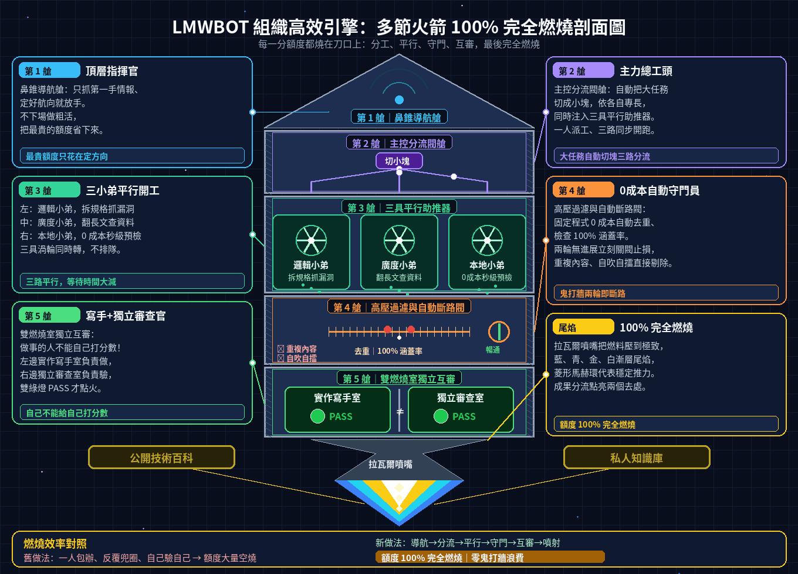

# BOT WIKI｜AI 模型實機評測、防鬼打牆工作流與 LMWBOT 白話指南

歡迎來到 **BOT WIKI**！這裡把我們實際在命令列（CLI）與日常工作中反覆測試整理的公開資料攤開給大家看，不講艱深術語，直接給最實用的結論與表格。

---

## 組織高效引擎：多節火箭 100% 完全燃燒剖面圖

- **第 1 艙【鼻錐導航艙｜頂層指揮官】**：只負責抓第一手情報與拍板航向，不下場做粗重活，省下最昂貴的頂層額度。
- **第 2 艙【主控分流閥艙｜主力總工頭】**：由主力大模型擔任總工頭，自動把大任務切成小塊，同時注入三具平行助推器。
- **第 3 艙【三具平行助推器｜三位專長小弟同時開工】**：左管**邏輯小弟**（拆規格、抓邊界漏洞）、中管**廣度小弟**（翻長文、上網查證）、右管**本地小弟**（0 成本秒級預檢、遮蔽個資）。
- **第 4 艙【高壓過濾與自動斷路閥｜0 成本自動守門員】**：固定程式自動剔除重複內容、檢查 100% 涵蓋率，不聽 AI 自吹自擂；連續兩輪沒進展立刻關閥止損。
- **第 5 艙【雙燃燒室獨立互審＆噴嘴尾焰｜寫手 ＋ 獨立審查官 ➔ 100% 完全燃燒】**：做事的人不能自己打分數！一位寫、另一位獨立審查官挑錯，雙重過關才點火推進，公開百科與私人知識庫自動分流歸檔。

> **三大場景通用**：同一具火箭支援 **一般人日常版**（辦公省錢防呆）、**工程師版**（命令列直接派工與兩輪無進展斷路）與 **影音創作者版**（話題雷達 ➔ 分鏡拆單 ➔ 腳本／視覺／語音三組小弟 ➔ 0 成本審片守門員 ➔ 16:9 與 9:16 一鍵雙出）三大場景。

---

## 目錄與完整文章

1. **[五大 AI 模型陣營 CLI 實機評測與 7 大職位黃金組合](pages/smith/model-providers-live-benchmark.html)**（[Canvas 互動版原始碼](pages/smith/model_providers_live_benchmark.canvas.tsx)）
2. **[AI 不鬼打牆工作手冊：做事與驗收分開的 6 個步驟](pages/smith/agentic-dual-loop-playbook.html)**（[Canvas 互動版原始碼](pages/smith/agentic_dual_loop_playbook.canvas.tsx)）
3. **[LMWBOT 系統白話指南：一般版、智慧版與工程圖版怎麼選](pages/smith/lmwbot-system-guide.html)**（[Canvas 互動版原始碼](pages/smith/lmwbot_system_guide.canvas.tsx)）

---

## 一、五大 AI 模型陣營 CLI 實機表現一覽表（直接攤開）

我們實際用程式同時調度各家模型的命令列工具（CLI），整理出最真實的速度、強項與常見踩坑點：

| 模型陣營 | 實測代表模型 | 實測回應時間 | 最強的地方 | 最適合拿來做什麼 | 實測踩坑提醒 |
|---|---|---|---|---|---|
| **Anthropic Claude** | `claude-opus` / `claude-sonnet` | 單輪 8~23 秒；多輪工具 45~120 秒 | CLI 工具鏈最完整，支援結構化輸出、回合限制與直接改檔測試 | 架構重構、長篇嚴謹推理、一人寫一人審（雙人互審） | 多輪任務久，背景執行要加上回合上限與逾時保護 |
| **OpenAI GPT Codex** | `gpt-5.4` / `codex exec` | 約 15~68 秒 | 支援沙箱執行與自動模式，規格拆解、邊界條件與格式檢查極準 | 規格拆解、找程式漏洞、設計故意出錯的測試題 | 預設沙箱可能是唯讀，要改檔案記得先開寫入權限；非 Git 資料夾要加略過檢查參數 |
| **Google Gemini CLI** | `gemini-2.5-pro` / `flash` / `3.5-flash-lite` | 約 12~25 秒 | 有免費額度、可塞極長文章、內建 Google 搜尋查證 | 一次掃描大量檔案、上網查最新技術資料、長文比對 | 同時發太多請求容易遇到 429 限流，要設自動等待重試 |
| **xAI Grok** | `grok` | 短問答通常為秒級 | 唯一能即時掌握 X (Twitter) 最新討論與開源專案第一手消息 | 當頂層總指揮、抓最新社群情報與趨勢 | 額度珍貴，適合只做「發號施令與抓情報」，粗重活交給其他模型跑 |
| **本地開源模型** | `Ollama`（`qwen` / `deepseek` / `llama`） | 約 1~5 秒 | 完全免費（0 API 費用）、斷網可用、資料 100% 留在自己電腦 | 高頻率語法檢查、把私人紀錄遮蔽個資、日常電腦問題初步分流 | 複雜邏輯與冷門系統指令較容易答錯，重要決定要交給固定檢查程式或雲端主力模型複核 |

---

## 二、7 大工作職位「怎麼搭配最省錢又最準」黃金組合

不用每件事都開最貴的模型！照職位這樣配最划算：

| 你的職位 / 情境 | 主力負責（大腦） | 協同搭檔（幫手） | 最後把關（守門員） | 為什麼這樣配最好用？ |
|---|---|---|---|---|
| **1. 軟體架構與全端工程師** | Claude Opus | Codex + Gemini | 本地模型 + 自動測試腳本 | Claude 負責大架構，Codex 幫忙找邊界漏洞，Gemini 掃跨檔案，最後用免費腳本自動跑測試 |
| **2. 演算法與自動化驗證工程師** | Claude Opus（寫手） | 另一個獨立的 Claude Opus（審查官） | 固定不變的 Python 驗收腳本 | 寫程式的人不能自己改考卷；審查官開全新視窗只看改動差異與結果圖，通過才算數 |
| **3. 產品經理與技術情報分析師** | Grok（抓 X 即時情報） | Gemini（Google 搜尋廣度查證） | Claude（整理成一頁白話報告） | Grok 抓第一手消息最快，Gemini 補齊背景資料，Claude 收斂成結論先行的決策表 |
| **4. 系統維運與電腦救援（IT 幕僚）** | 本地 Ollama（離線分流） | Claude（產生唯讀檢查指令） | 只讀不改的安全白名單 | 電腦出問題常斷網或有隱私紀錄，先在本地分流遮蔽個資，再產生「只看不改」的安全診斷步驟 |
| **5. 資安紅隊與合規檢查人員** | Claude（把規範轉成檢查規則） | Codex（專門造假資料測試漏洞） | 本地離線掃描腳本 | 一個立規矩、一個專門想辦法鑽漏洞測試，最後在本地離線掃描確保機密不外流 |
| **6. 獨立開發者 / 省預算團隊** | Gemini 免費額度（查資料探路） | 本地模型（日常寫小工具與改寫） | Claude（只在卡關的刀口出手） | 免費與本地模型吃掉 80% 日常雜事，付費額度只花在最難的 20% 關鍵問題上 |
| **7. 影音與短影音創作者（YouTube / Reels / Shorts / 動畫）** | Claude 分鏡總導演 ＋ Grok / Meta 社群話題雷達 | 本地 Flux / Playwright 首尾幀 ＋ 互動式 AI 局部改圖與繁中無痕改字 ＋ Whisper / Edge-TTS 語音字幕 ＋ Veo / Sora 刀口點火 | FFmpeg 0 成本音畫同步、-14 LUFS 響度與繁體字幕守門員 | 生影片點數比文字貴 10~50 倍，先用免費工具定稿分鏡與首尾幀；首尾幀有瑕疵就用互動式 AI 局部改圖只修圈選處（圈外一個像素都不動）、繁中標題無痕改字零亂碼、橫圖一鍵擴成直圖；守門員過關才點火，連續兩輪不及格就斷路重寫，零廢片且 16:9 與 9:16 一鍵雙出 |

> 首尾幀改圖再升級：**點哪裡改哪裡**（點一下、框一塊、圈一圈自動帶座標標籤進對話框，一句話同時改三處，圈外像素鎖死）、**一鍵拆圖層**（底圖、主體、文字層分開，標題拖著走還能改字）、**本地 0 成本預渲染兩段式**（先秒出草稿過品管閘門，滿意才花一次高清點數，重繪幅度鎖 0.35 不抽卡）。

---

## 三、AI 開發不鬼打牆的 6 個白話原則

很多人用 AI 寫程式常遇到「去倒杯水回來，AI 在同一個錯誤裡鬼打牆重試 50 次把額度燒光」。我們實測最有效的解法只有一句話：**做事的人不能自己打分數**。

1. **一次只切一小塊**：每次只派一個明確小任務（例如修好一個功能或補 15 題測試），不把所有事情綁成一大包。
2. **總工頭帶小弟分工**：讓主力模型當總工頭，自動把工作拆給擅長邏輯（Codex）、擅長翻長文（Gemini）與免費快速（本地模型）的小弟同時做。
3. **先去重再收件**：收回來的產出先用程式比對，跟舊資料重複的直接剔除，不灌水。
4. **用固定程式驗收（不聽 AI 自吹自擂）**：不管 AI 嘴巴說「我做好了、100% 沒問題」都不算數，一律交給鎖死不能偷改的檢查腳本跑分。
5. **雙人獨立互審**：一個 AI 負責寫，另一個完全沒看過對話過程的獨立 AI 負責挑毛病，確認沒有偷懶作弊才放行。
6. **兩輪沒進展立刻踩煞車**：如果連續改兩次分數都沒進步，程式自動停機換方向，絕不放任它無限重試燒錢。

---

## 四、LMWBOT 桌面系統三版本一覽

| 版本 | 一句話說明 | 適合誰 |
|---|---|---|
| **一般版（日常救機與工作助理）** | 用白話幫你檢查電腦為什麼變慢、網路為什麼不通，預設「只看不改」保護電腦安全 | 一般使用者、需要離線隱私的個人電腦 |
| **智慧版（三層智慧派工引擎）** | 內建「總工頭自動帶小弟 ＋ 自動去重安全守門 ＋ 獨立審查官驗收」，複雜任務一次搞定 | 軟體工程師、研究人員、重度 AI 使用者 |
| **工程圖版（專業圖面與結構解析）** | 針對專業工程圖面提供視覺與拓樸結構雙重檢查，幫工程師抓出連線與規格疏漏 | 硬體、電力、管線與室內設計等工程人員 |
